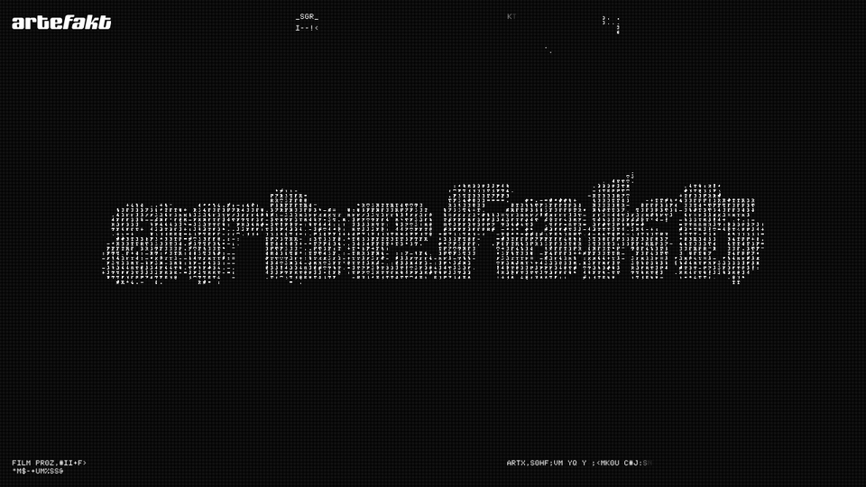

# Artefakt.mov — capture reference

**Inline media:** Markdown preview often hides local images. Open [`artefakt-mov-reference.html`](artefakt-mov-reference.html) in a browser to see the **GIF** and notes together.

**Site:** [https://artefakt.mov/](https://artefakt.mov/)  
**Motion:** ~3s GIF at `assets/artefakt-mov-capture.gif` (12 fps, 960 px wide). Regenerate: `pnpm run capture-artefakt-gif` (Playwright + ffmpeg). Still PNG: `assets/artefakt-mov-screenshot.png`.

## What stands out

- Dark field with a fine pixel/grid grain (CRT-ish read without full scanline gimmick).
- Huge wordmark top-left, `:/ MENU` top-right in a tight mono/pixel stack.
- Center band of dense glyph/ASCII noise with big headline on top: “FILM PRODUCTION” / “REIMAGINED.”
- All-caps mono blurb anchored low; high contrast, minimal chrome.

## Motion (~3s)

