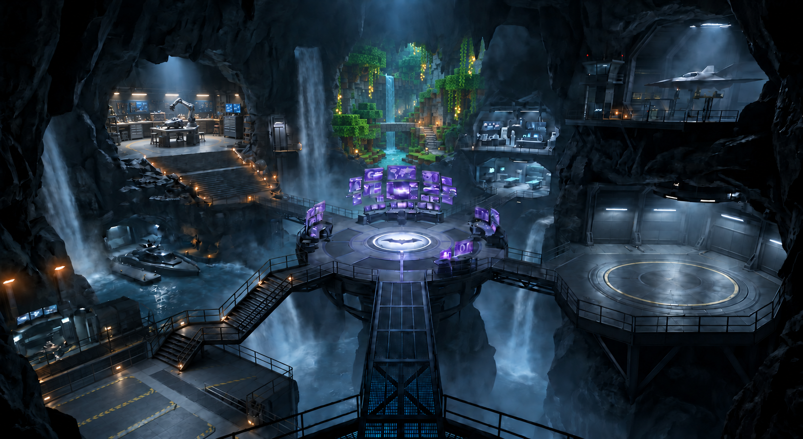
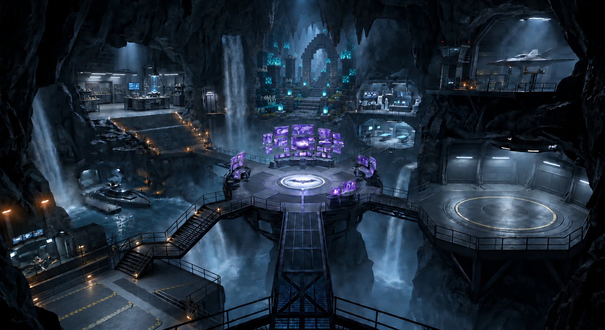
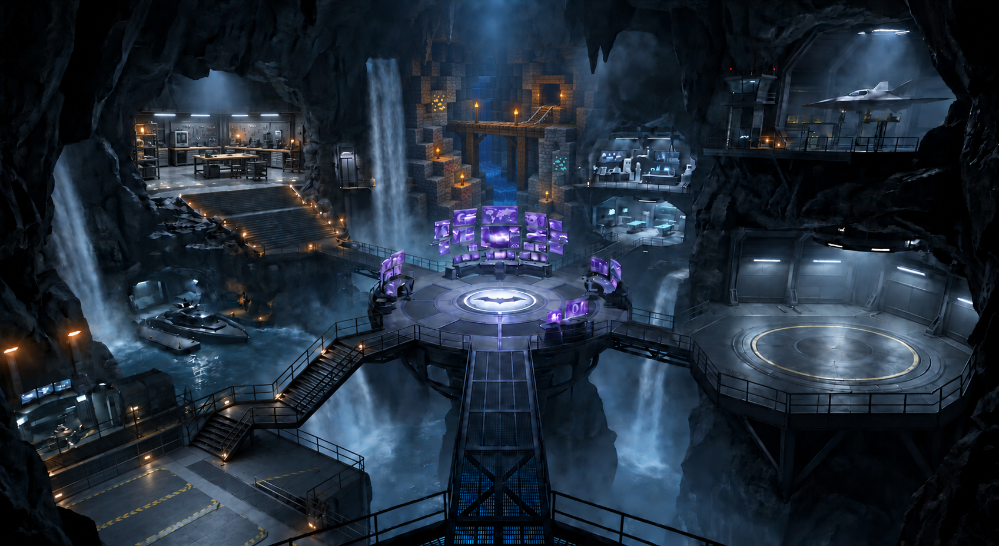
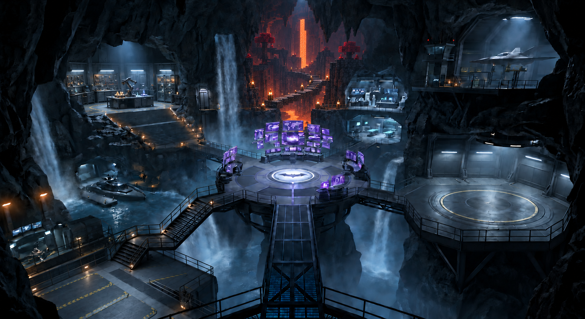
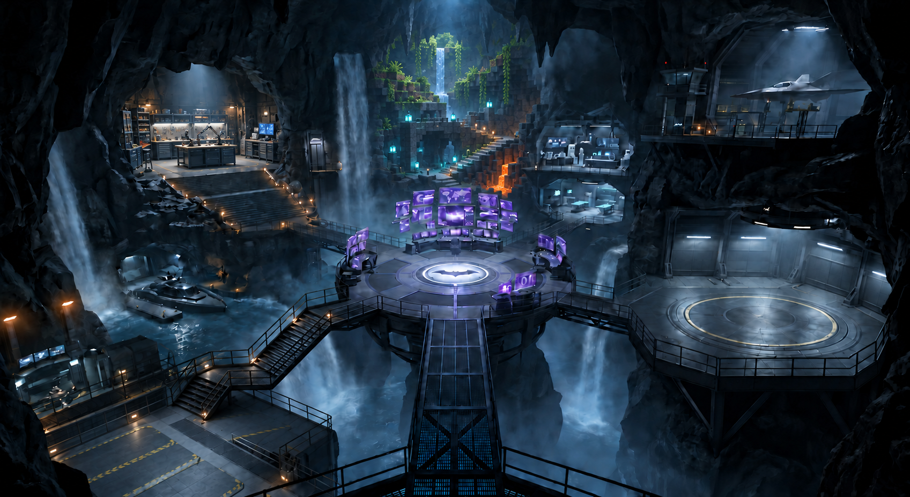

# Workshop + central Voxelize cave — revision 2

The upper-left platform keeps its original footprint, staircase, and cave enclosure and receives a designed modern workshop interior. Voxel terrain is confined to the middle rear cave behind the central purple monitors. The right laboratory alcoves and other major architecture remain in place.

Generated with the built-in imagegen tool from [the original reference](../../images/batcave-empty-platform-v4.png). These are concept images, not implemented gameplay or edited Blender assets.

[Integration plan](../voxelize-blender-integration.md) · [Exact prompts](prompts.md) · [Previous wider layouts](../voxelize-layouts/README.md)

## Lush cave + robotics workshop

A contained garden cavern behind the monitors; an upper-left robotics bench with articulated tools.

## Ancient city + precision workshop

A receding deepslate avenue and cyan-lit ruins; a precise mechanical assembly room on the left.

## Mining cave + fabrication workshop

A narrow mine ravine with timber routes; a modern fabrication room with printers and tool storage.

## Nether cave + materials workshop

A recessed lava fissure and basalt bridge; a cool, contained materials-testing workshop.

## Layered biomes + maker workshop

Green upper ledges, ancient middle ruins and a small lower lava channel; a versatile workshop on the left.

