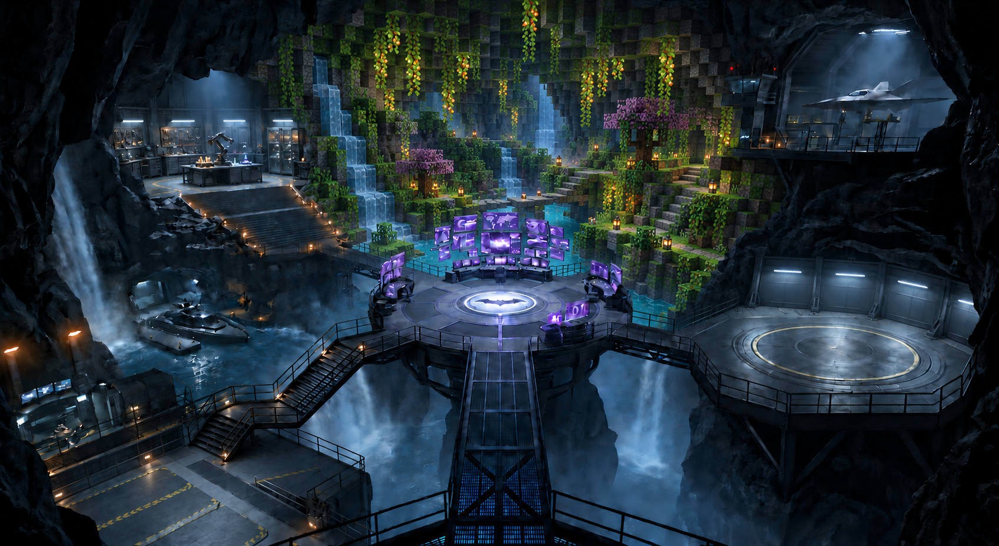
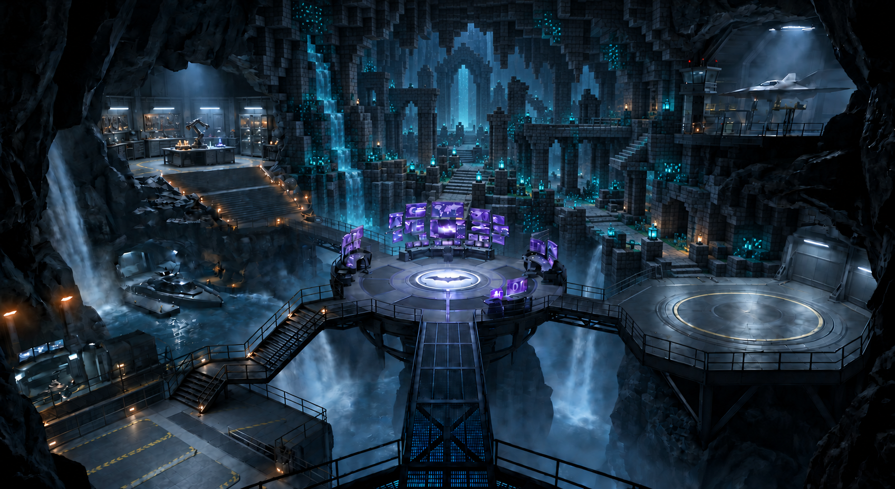
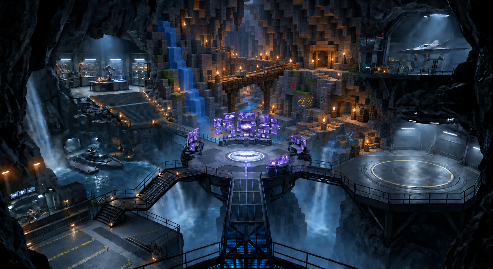
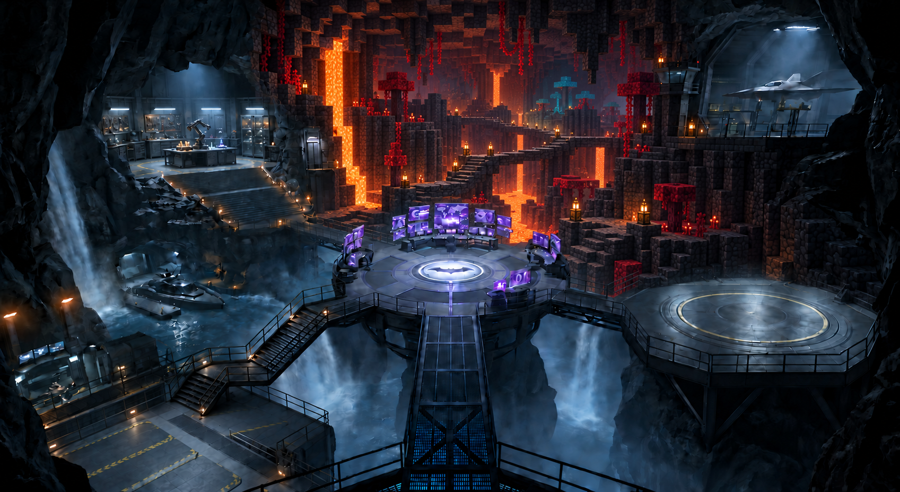
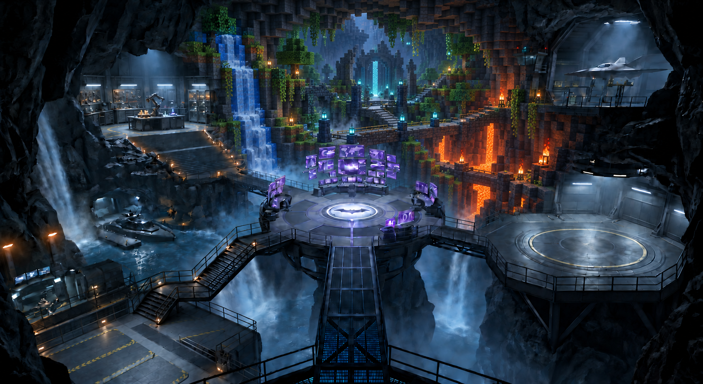

# Entire rear section becomes Voxelize — revision 3

The user's [cropped scope reference](section-reference.png) defines the region: the waterfall and adjacent rock, central cave, rear walkways, and both stacked right laboratory spaces become a broad connected voxel environment. Purple foreground screens remain. The upper-left workshop and major foreground platforms stay outside the conversion.

These five full-frame concepts were generated with the built-in imagegen tool using the [revision 2 full scene](../voxelize-layouts-v2/04-nether-basalt.png) and the user crop. They are image studies, not a Blender or gameplay implementation.

[Integration plan](../voxelize-blender-integration.md) · [Exact prompts](prompts.md)

## Full lush cavern

A broad block-built garden and waterfall basin occupying the former waterfall, central cave, and both right rooms.

## Full ancient city

A connected deepslate city with a central avenue and two tiers of ruins replacing the right laboratories.

## Full mining cavern

One wide ravine with a voxel waterfall, mine trestles, and connected ore terraces.

## Full Nether cavern

A continuous volcanic landscape with lavafalls, branching basalt causeways, and former lab volumes turned into fortress ledges.

## Full connected biome landscape

Lush cliffs, ancient ruins, and a volcanic lower terrace joined across the entire rear section.

