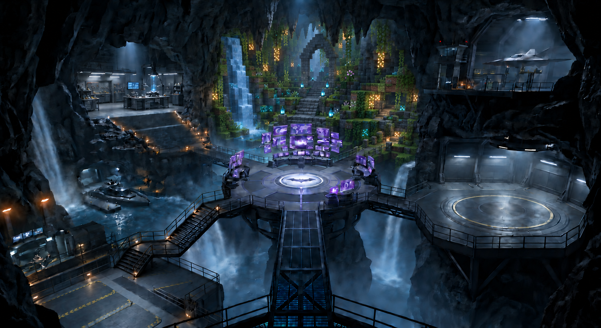
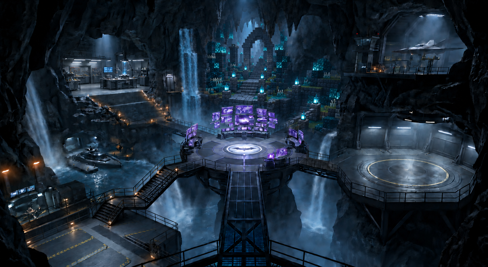
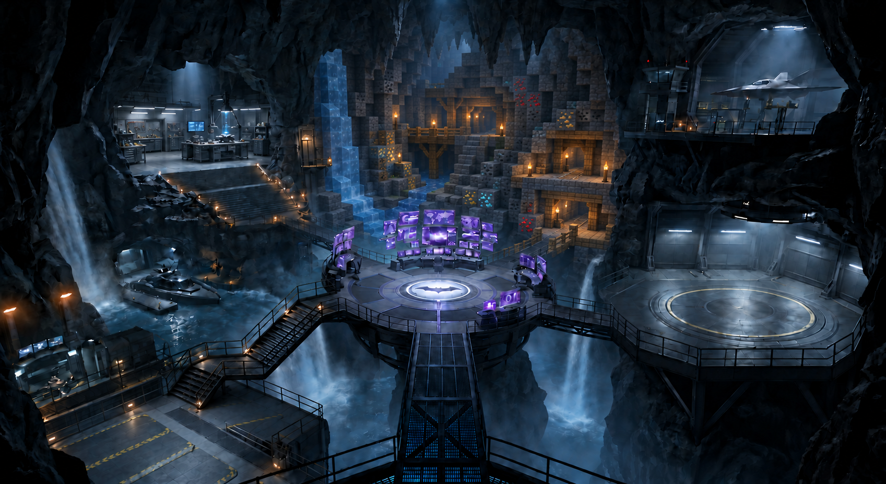
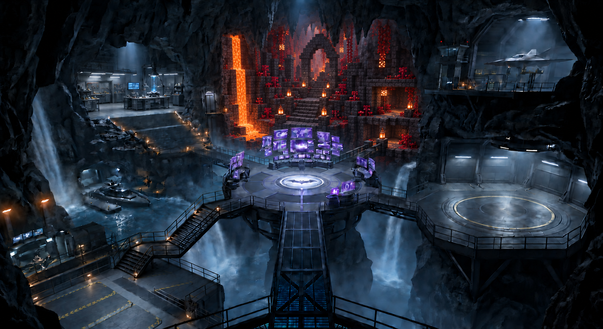
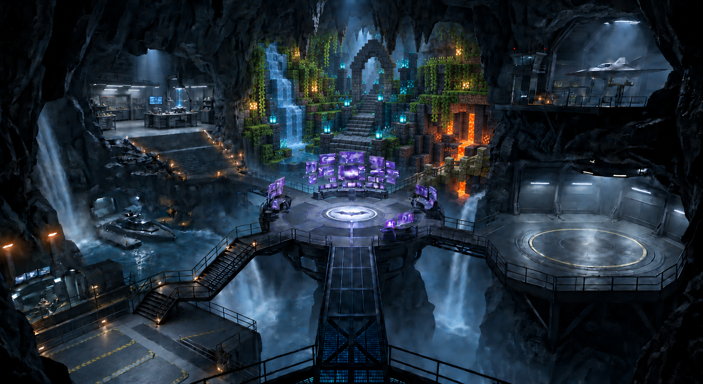

# Framed voxel interior + half-metal / half-voxel bridge — revision 4

Five revised concepts follow the user's marked boundary. The voxel interior stays recessed inside the original organic rock frame, and the workshop remains separate. The purple screens remain in front.

The short diagonal rear-right bridge, from the command deck toward the lower voxel terrace, is the hybrid bridge: metal near the deck, block construction toward the terrain, with a joint halfway along its length. The foreground bridge and connection to the large empty circular right platform remain metal.

[Integration plan](../voxelize-blender-integration.md) · [Exact prompts](prompts.md) · [Unmarked composition close-up](section-reference-unmarked.png)

Generated with the built-in imagegen tool. These are layout studies, not changes to the Blender scene or gameplay implementation. The lush image received a targeted bridge correction.

## Framed lush cave

Moss terraces and a block waterfall recessed within the original rock arch; a steel-to-mossy-stone entry bridge.

## Framed ancient city

Cyan-lit deepslate ruins inside the original terrain frame; the rear-right bridge changes from metal to block stone halfway.

## Framed mining cave

A compact mine ravine with ore ledges behind natural rock; the short entry bridge is half steel and half block-built timber.

## Framed Nether cave

A contained basalt-and-lava recess behind the intact rock rim, entered over a half-steel, half-blackstone bridge.

## Framed mixed-biome cave

A bounded garden, ruined courtyard and small lava fissure sharing one natural frame, with a visible midpoint bridge transition.

