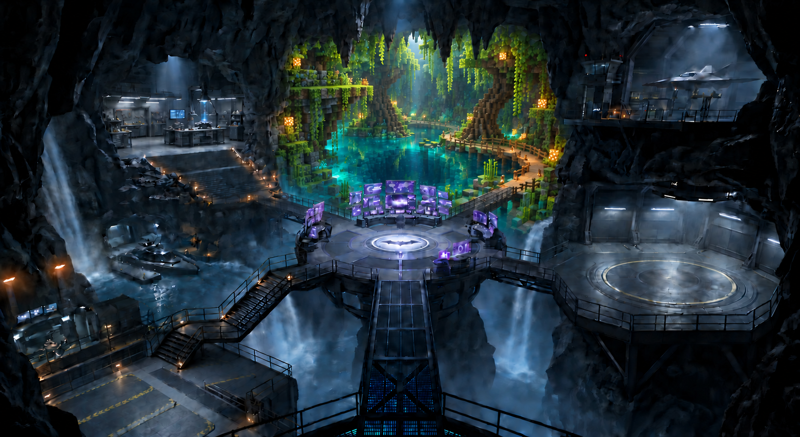
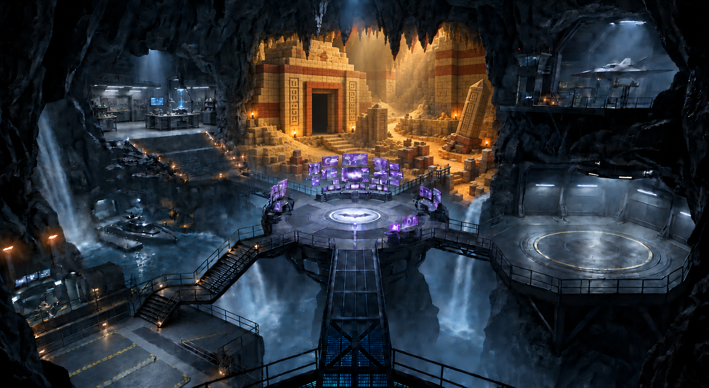
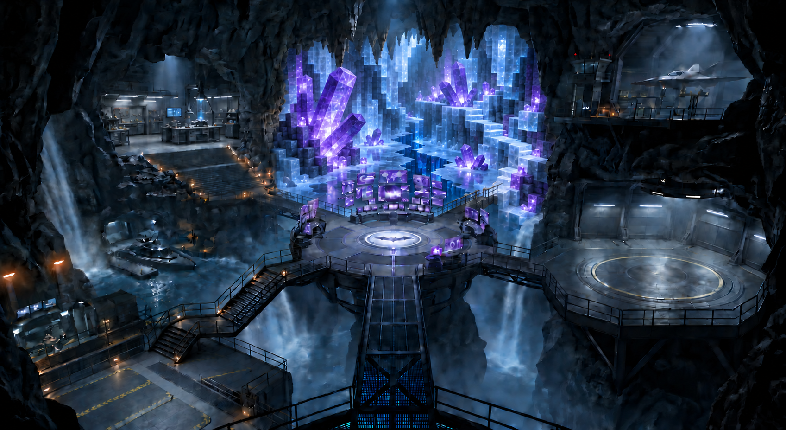
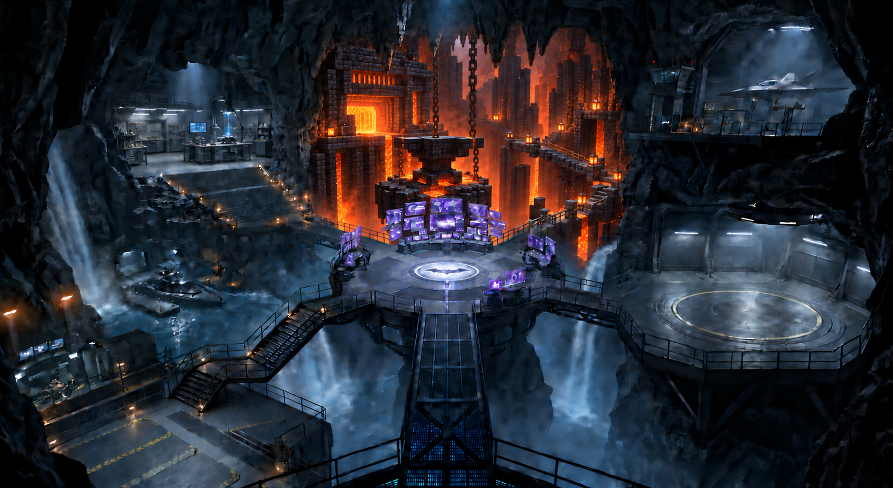
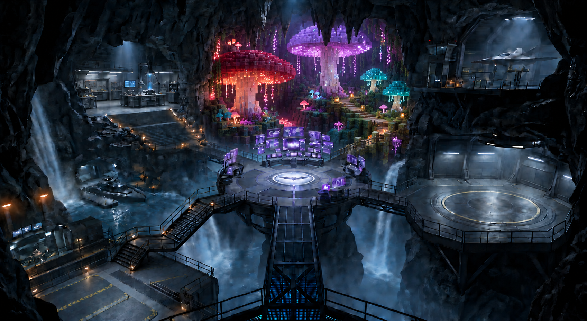

# Five distinct voxel interiors

Revision 5 keeps the approved recess boundary, natural rock frame, workshop and half-metal/half-voxel rear-right bridge. Each interior has different terrain shapes, focal structures and routes.

## Flooded jungle sinkhole

A vast turquoise flooded sinkhole with a deep circular central water void occupying the middle. Giant block-built jungle roots descend from dense cubic leaf canopy, mossy limestone shelves cantilever on opposite sides. An asymmetrical low timber boardwalk curves around the pool from the right bridge entry, with stepping stones and small reeds. Broad horizontal water and hanging foliage are the focal shapes, NOT any temple/ruins/arch/staircase. Sunlit emerald and turquoise, warm subtle glowberries. No large waterfall.

## Buried desert temple

A dry golden sandstone archaeological chamber dominated by a squat solid stepped pyramid offset left, half buried in cubic sand dunes, with an enormous rectangular dark doorway and geometric carved sandstone reliefs. A low winding excavation trench travels from the right entry between dunes and toppled obelisks. Strong warm amber light, dusty shafts, terracotta bands, sparse torch sconces. Monumental SOLID mass and descending trench, not a tall arch or central ascending staircase. No water, vines, ice, lava or glowing cyan.

## Amethyst ice grotto

A glacial crevasse with enormous cubic stepped amethyst crystal clusters protruding diagonally from alternating walls, a low frozen mirror lake, and a jagged deep-blue fissure cutting across it. Thin zigzag ice-block stepping ledges lead from right entry around crystal spires. Bright white-blue translucent ice and violet facets, crystalline reflected light, visibly block-built voxel crystals rather than smooth polygons. Dominant angular spike silhouettes and open negative space. No ruined architecture, arch, broad staircase, vegetation or waterfall.

## Volcanic forge

A monumental underground block-built forge over a deep vertical molten fissure. A massive square blackstone furnace embedded high at LEFT, its rectangular orange furnace mouth illuminating a giant blocky anvil on a suspended central basalt island. Narrow angular chain-supported block causeways connect staggered islands from the right entry above glowing lava far below. Tall basalt columns on the back wall, ember haze, red-hot channels. Strong asymmetrical vertical void, charcoal and orange. No pointed arch, old source terraces, central staircase, water or foliage.

## Giant mushroom forest

An enchanted underground forest of three huge stepped voxel mushroom umbrellas at very different heights: broad crimson cap left, towering lavender cap rear center, small luminous teal caps right. Thick pale cubic stems and broad caps define the silhouette. Undulating mycelium islands at ground level with a winding low wooden block path connecting from the right bridge, tiny luminescent fungi and hanging spore-like lights. Magenta, muted coral and soft green glow. Cozy dense organic block forest, no monumental stone ruins, arch, central stairs, waterfalls, pyramid, ice or lava.

Generated using the built-in image tool. [Exact prompts](prompts.md) · [Screen restoration prompt](screen-restoration-prompt.md) · [Integration plan](../voxelize-blender-integration.md)
