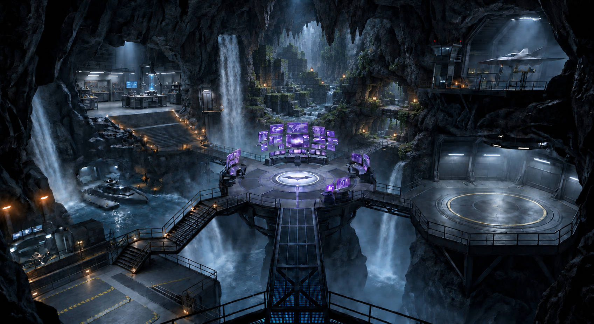
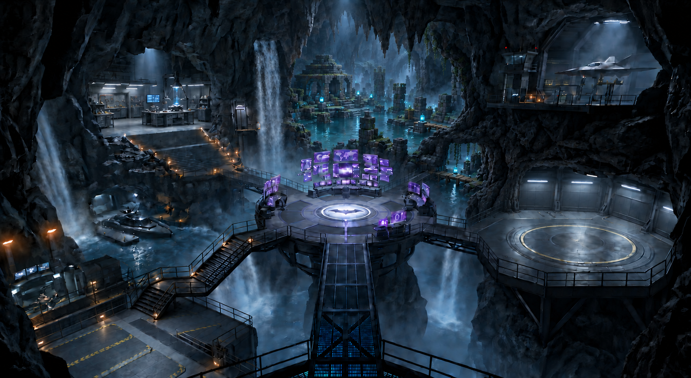
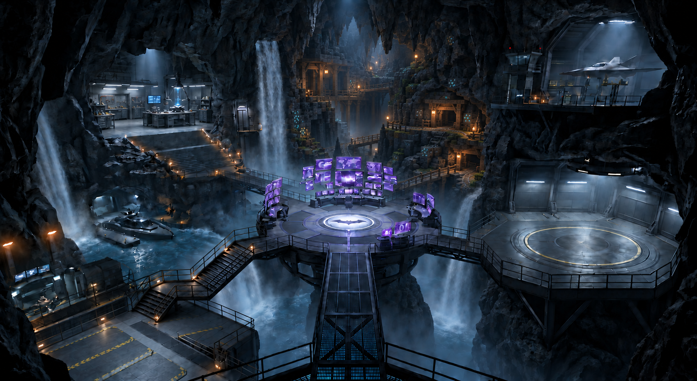
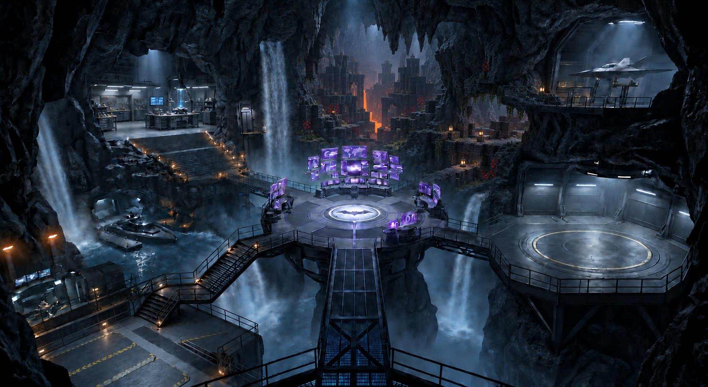
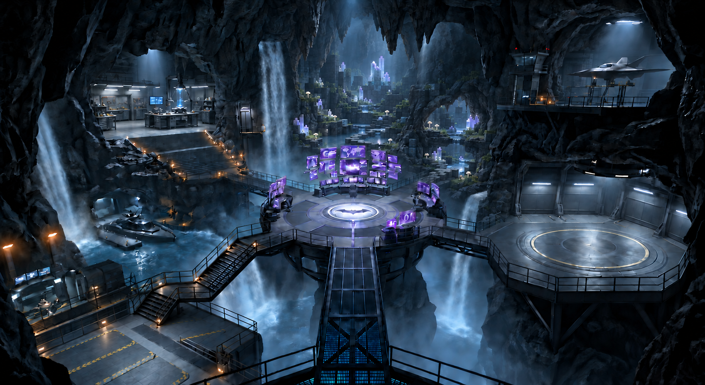

# Revision 6 — more natural framing, subtler transitions

Five concepts retain the left natural waterfall and thicker organic rock shoulders, overhangs and dividing ledges. Shared stone colors, atmosphere and restrained accent light soften the transition to recessed voxel terrain. The short rear-right bridge keeps the metal-to-voxel transition.

## Mossy ravine

## Drowned ruins

## Abandoned mine

## Obsidian rift

## Moonlit crystal garden

[Prompts](prompts.md) · [Boundary correction prompts](corrections.md) · [Integration plan](../voxelize-blender-integration.md)
