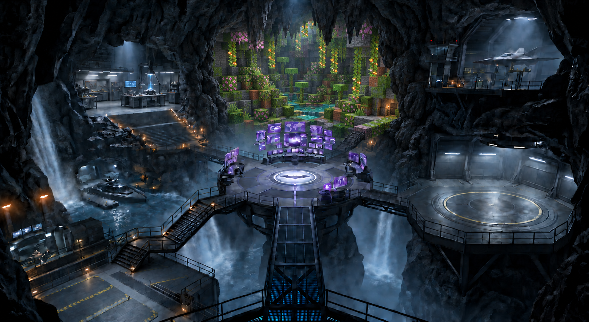
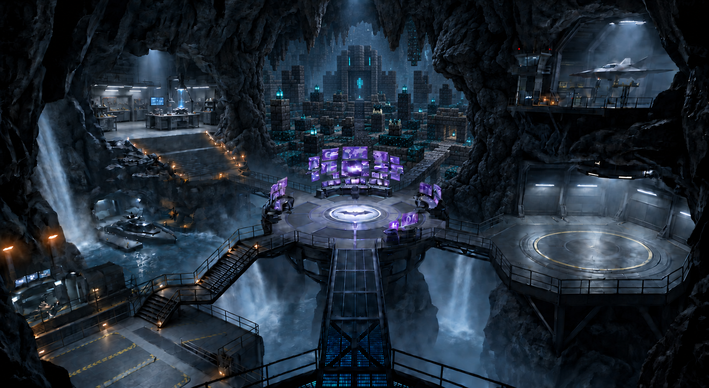
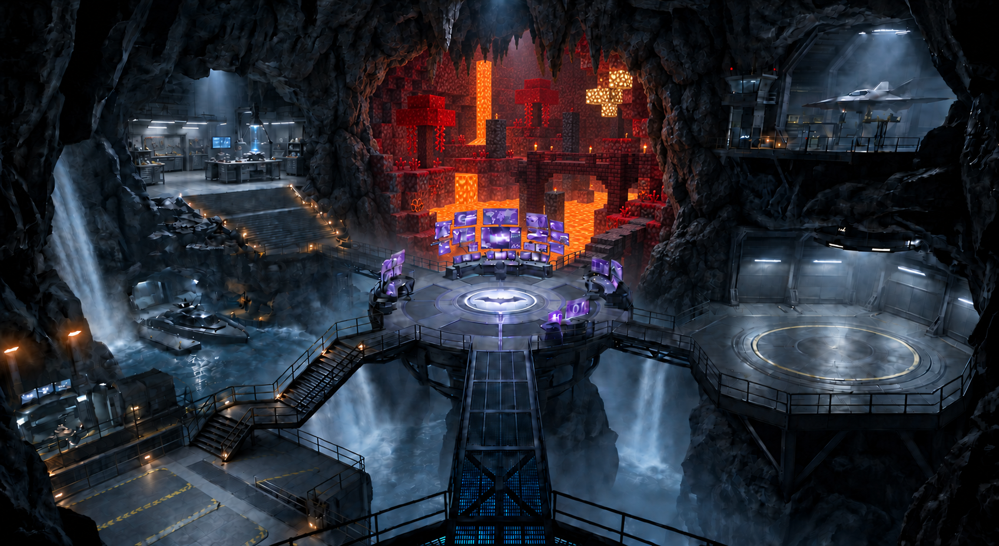
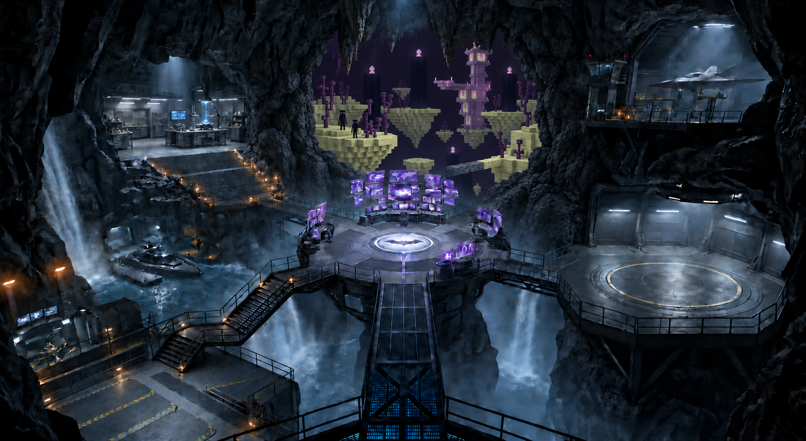
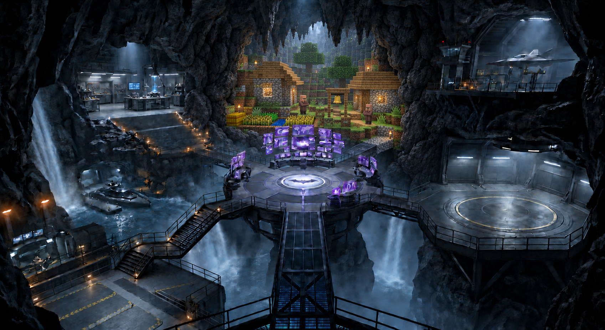

# Revision 7 — Minecraft biomes inside a Blender cave

Five distinct Minecraft-style interiors with cubic terrain and pixel textures. The rear waterfall and elevator are removed, and the natural rock border on the right is thicker. The workshop, screens and surrounding headquarters remain realistic. The rear-right bridge transitions from steel to voxel blocks.

## Lush cave

## Ancient city

## Nether

## The End

## Villager village

Generated with the built-in image tool. [Exact prompts](prompts.md) · [Integration plan](../voxelize-blender-integration.md)
