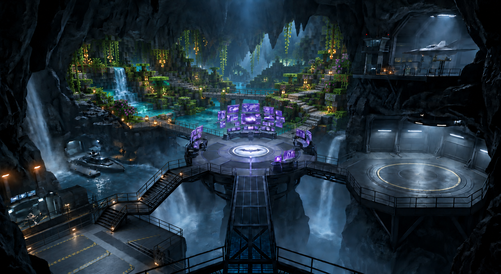
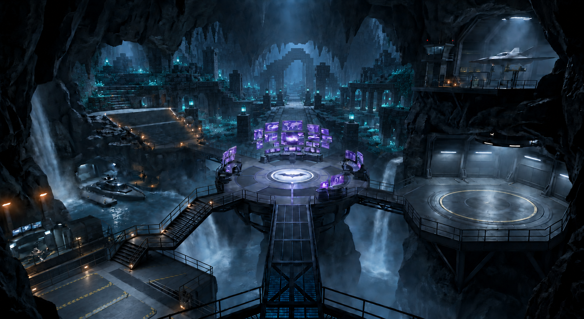
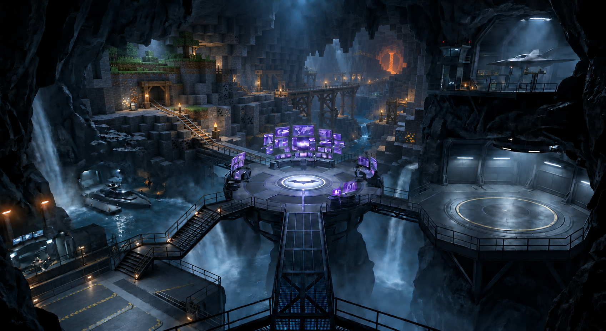
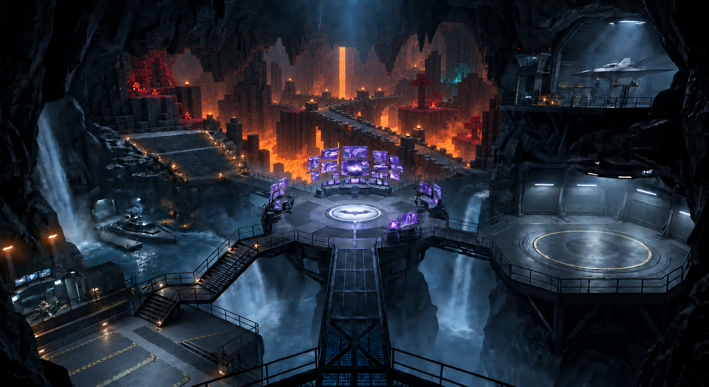
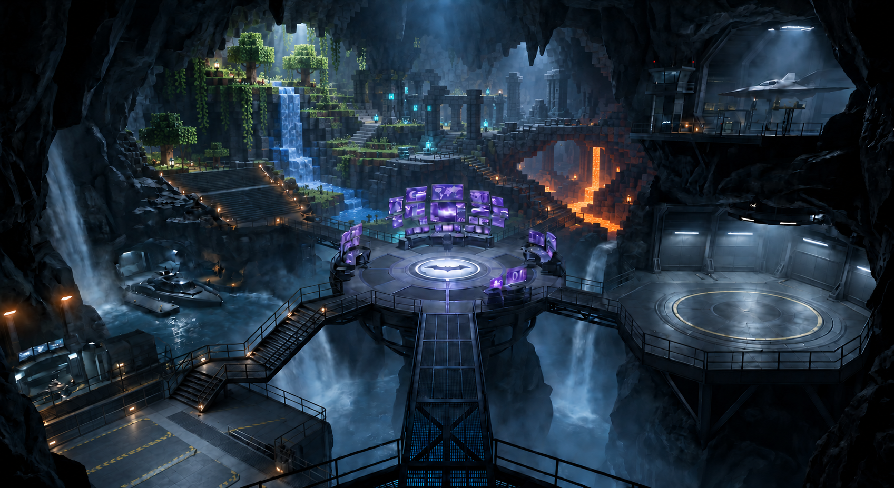

# Voxelize rear-cavern concepts

Five independent edits of [the original reference](../../images/batcave-empty-platform-v4.png), generated on 2026-09-29 using the built-in imagegen tool. Each replaces the three rear alcoves with one connected playable environment while preserving the foreground composition.

[Integration plan](../voxelize-blender-integration.md) · [Exact prompts](prompts.md)

## Lush cave amphitheater

A broad terraced garden, shallow river, and winding paths in one continuous rear cavern.

## Ancient city excavation

A deep central avenue, sunken courtyard, and stepped ruins with restrained cyan lighting.

## Classic mining cavern

A diagonal ravine crossed by timber trestles, with mine terraces and exposed ores.

## Nether basalt causeway

An elevated playable causeway over a recessed lava basin, framed by basalt formations.

## Layered biome cavern

A connected vertical landscape: lush upper terraces, ancient middle ruins, and a lower volcanic fissure.

These are visual layout studies, not implemented gameplay or finished Blender models.

